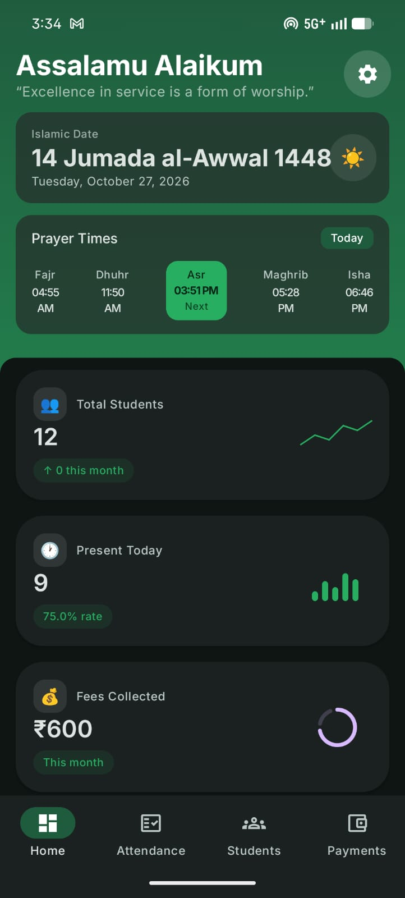
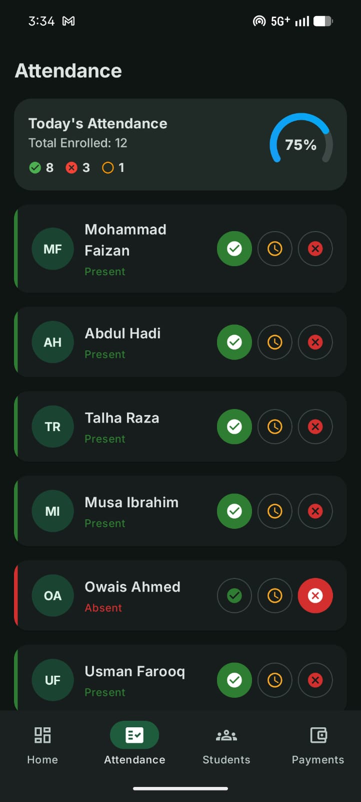
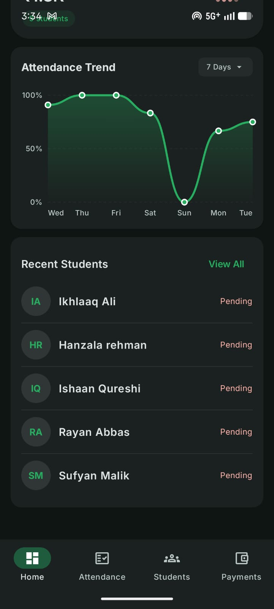
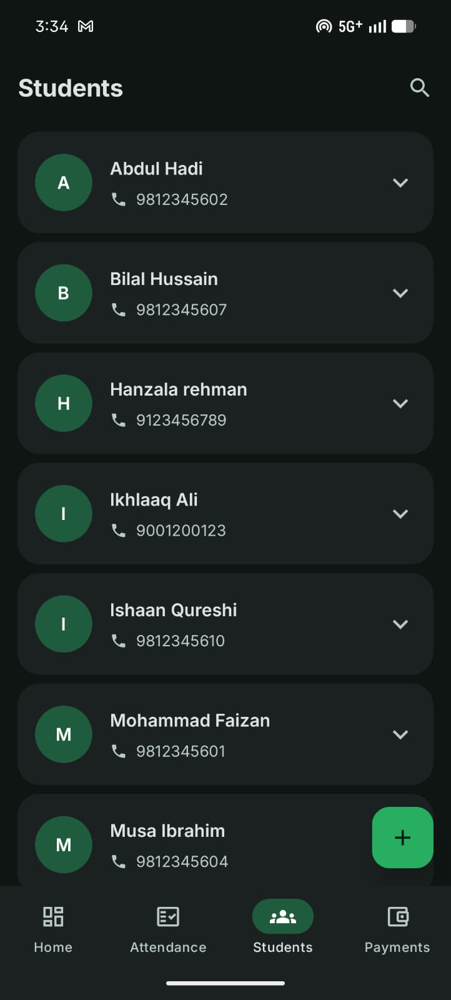
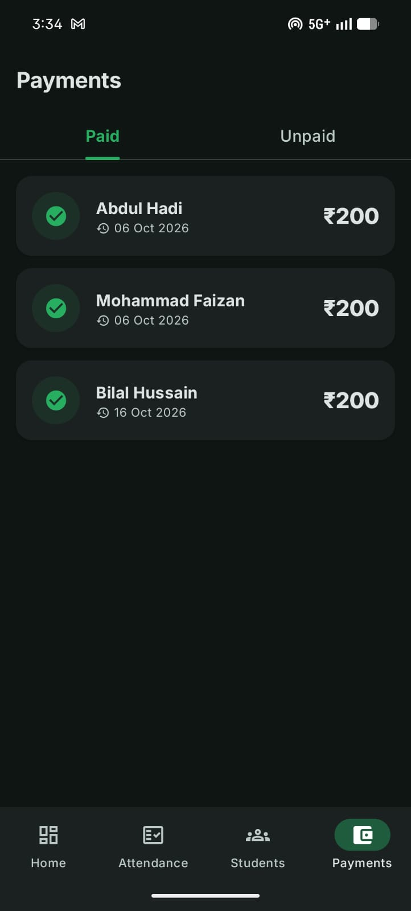
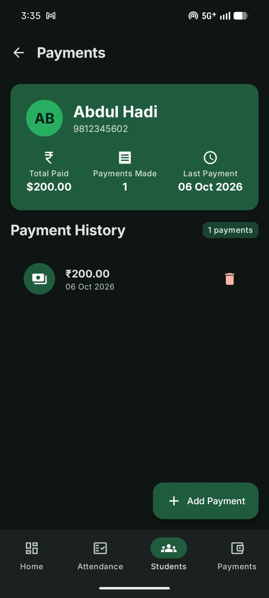
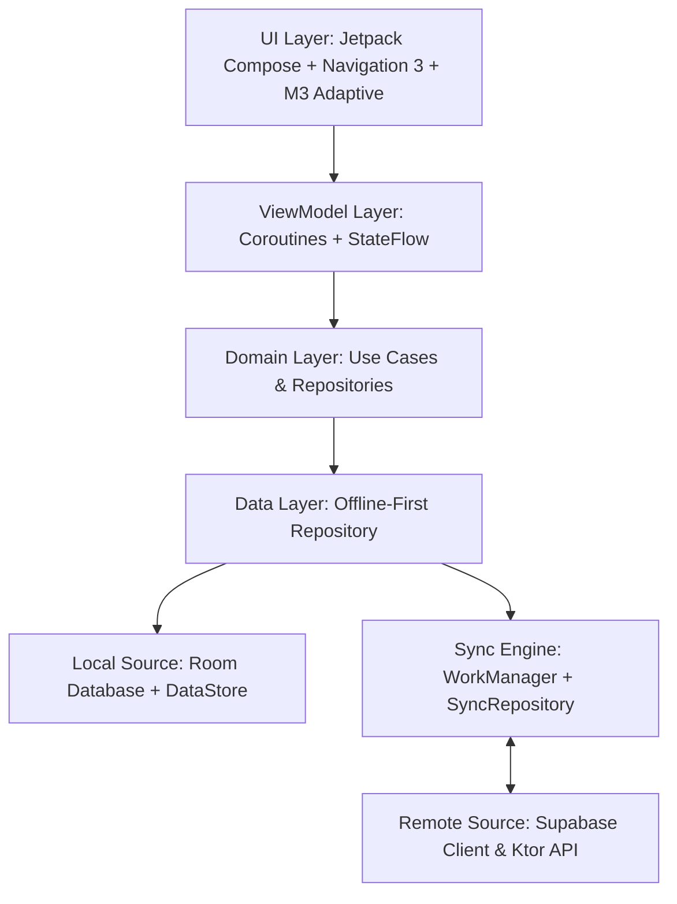

# 🕌 Umar Masjid - Maktab Management App

[](https://developer.android.com)
[](https://kotlinlang.org/)
[](https://developer.android.com/jetpack/compose)
[](https://supabase.com/)
[](https://developer.android.com/topic/architecture)
[](LICENSE)

**Umar Masjid - Maktab Management** is an open-source, production-grade Android application built with **Jetpack Compose** and **Offline-First Architecture**. It is designed specifically for Islamic centers, Masajid, and traditional Maktabs to manage student enrollments, daily attendance, fee/tuition collections, visual analytics, and prayer schedules seamlessly.

Designed to operate seamlessly in locations with limited or unstable internet connectivity, the app leverages a **local-first storage strategy** backed by **Room Database** and performs differential background synchronization with **Supabase**.

---

## 💡 The Idea Behind the App

Managing daily operations in local Maktabs and Islamic educational centers often relies on paper registers or manual ledger books. This leads to common challenges:
- **Attendance & Record Loss:** Manual registers are prone to damage or loss.
- **Tuition & Fee Tracking Issues:** Difficulty keeping track of monthly fees, pending payments, and payment histories.
- **Connectivity Constraints:** Masajid often lack reliable high-speed Wi-Fi or cellular networks, making cloud-only solutions impractical.
- **Lack of Integrated Tools:** Teachers need an all-in-one assistant for both Maktab administration and daily Islamic prayer timings.

**Umar Masjid - Maktab Management** solves these problems by providing:
1. **Zero-Latency Offline Management:** Teachers can enroll students, mark daily attendance, and process payments without needing an active internet connection.
2. **Automated Conflict-Free Synchronization:** All offline actions are queued locally and automatically synced with a cloud backend (Supabase) via Android WorkManager when connectivity returns.
3. **Integrated Prayer Companion:** Real-time Islamic prayer times powered by location services and the Aladhan API, including Glance Home Screen widgets.
4. **Community & Beginner Friendly Codebase:** Built using modern Android development practices (Navigation 3, Hilt, Room, Ktor, M3 Adaptive layouts), making it an ideal real-world project for beginner and experienced developers to contribute to and learn from.

---

## 📱 Screenshots & Key Functionality

| Home & Prayer Times | Daily Attendance Marking | Visual Analytics Graph |
| :---: | :---: | :---: |
|  |  |  |
| Live prayer times, next prayer countdown, and quick dashboard navigation. | Fast, single-tap student attendance marking (Present, Absent, Late). | Monthly attendance trends and visual distribution bar charts. |

| Student Management | Payment & Fee Records | Payment Details |
| :---: | :---: | :---: |
|  |  |  |
| Enroll new students, view rosters, search, and manage profiles. | Track monthly fee collections, paid/unpaid status, and totals. | Record individual payments, custom notes, and financial histories. |

---

## 🏗️ Architecture & Tech Stack

The application follows the official **Android Architecture Guidelines** and adheres to modern reactive, modular programming principles.



### Key Technologies & Libraries
- **Language:** 100% [Kotlin](https://kotlinlang.org/)
- **UI Framework:** [Jetpack Compose](https://developer.android.com/jetpack/compose) with Material 3, Material 3 Adaptive Layouts, and Compose Icons.
- **Navigation:** [Jetpack Navigation 3](https://developer.android.com/guide/navigation/navigation-3) for type-safe UI flows.
- **Dependency Injection:** [Hilt](https://dagger.dev/hilt/) for compile-time dependency injection.
- **Local Persistence:** [Room Database](https://developer.android.com/training/data-storage/room) for local caching & [DataStore Preferences](https://developer.android.com/topic/libraries/architecture/datastore) for app configurations.
- **Networking:** [Ktor Client](https://ktor.io/) for REST endpoints (Aladhan Prayer API).
- **Backend-as-a-Service:** [Supabase Kotlin SDK](https://github.com/supabase-community/supabase-kt) (Postgrest & Auth) for cloud backend and user authentication.
- **Background Sync:** [Android WorkManager](https://developer.android.com/topic/libraries/architecture/workmanager) for robust offline job scheduling and background sync.
- **Home Screen Widget:** [Jetpack Glance AppWidget](https://developer.android.com/jetpack/compose/glance) for interactive prayer time desktop widgets.

---

## ⚡ Offline-First Synchronization Architecture

The app uses a robust **Local-First, Single-Source-of-Truth (SSOT)** model:

1. **Local Mutation:** Every user operation (e.g., enrolling a student, updating attendance, recording a payment) is written immediately to the local **Room Database** and logged into a `sync_operations` local queue table.
2. **Incremental Delta Sync:** During synchronization, the app compares its local cursor version (`SyncCursorEntity`) with the remote `sync_changes` version counter in Supabase.
3. **Sequenced Batch Application:** Remote changes are pulled and applied sequentially (`STUDENT` ➔ `ATTENDANCE` ➔ `PAYMENT`) to enforce strict SQL referential integrity.
4. **Soft Deletions:** Entity deletions are soft-deleted using a `deleted_at` timestamp column to ensure auditability and consistent cross-device synchronization.

---

## 🗄️ Supabase Backend Structure & Database Schema

To set up your backend efficiently, execute the following SQL script in your **Supabase SQL Editor**. This script sets up tables, indexes, triggers, Row-Level Security (RLS), and Remote Procedure Call (RPC) functions required for offline delta sync.

```sql
-- Enable UUID extension
CREATE EXTENSION IF NOT EXISTS "uuid-ossp";

-- ============================================================================
-- 1. TABLES DEFINITION
-- ============================================================================

-- Students Table
CREATE TABLE public.students (
    id UUID PRIMARY KEY DEFAULT gen_random_uuid(),
    teacher_id UUID NOT NULL DEFAULT auth.uid(),
    name TEXT NOT NULL,
    phone_number TEXT NOT NULL,
    enrollment_date DATE NOT NULL,
    created_at TIMESTAMPTZ NOT NULL DEFAULT now(),
    updated_at TIMESTAMPTZ NOT NULL DEFAULT now(),
    deleted_at TIMESTAMPTZ DEFAULT NULL
);

-- Attendance Table
CREATE TABLE public.attendances (
    id UUID PRIMARY KEY DEFAULT gen_random_uuid(),
    student_id UUID NOT NULL REFERENCES public.students(id) ON DELETE CASCADE,
    attendance_date DATE NOT NULL,
    attendance_status TEXT NOT NULL CHECK (attendance_status IN ('PRESENT', 'ABSENT', 'LATE')),
    created_at TIMESTAMPTZ NOT NULL DEFAULT now(),
    updated_at TIMESTAMPTZ NOT NULL DEFAULT now(),
    deleted_at TIMESTAMPTZ DEFAULT NULL,
    CONSTRAINT unique_student_attendance_date UNIQUE (student_id, attendance_date)
);

-- Payments Table
CREATE TABLE public.payments (
    id UUID PRIMARY KEY DEFAULT gen_random_uuid(),
    student_id UUID NOT NULL REFERENCES public.students(id) ON DELETE CASCADE,
    payment_date DATE NOT NULL,
    amount NUMERIC(10, 2) NOT NULL,
    note TEXT DEFAULT NULL,
    created_at TIMESTAMPTZ NOT NULL DEFAULT now(),
    updated_at TIMESTAMPTZ NOT NULL DEFAULT now(),
    deleted_at TIMESTAMPTZ DEFAULT NULL
);

-- Change Tracking Table for Incremental Delta Sync
CREATE TABLE public.sync_changes (
    version BIGINT GENERATED ALWAYS AS IDENTITY PRIMARY KEY,
    entity_type TEXT NOT NULL, -- 'STUDENT', 'ATTENDANCE', 'PAYMENT'
    entity_id UUID NOT NULL,
    operation TEXT NOT NULL,   -- 'INSERT', 'UPDATE', 'DELETE'
    changed_at TIMESTAMPTZ NOT NULL DEFAULT now()
);

-- ============================================================================
-- 2. INDEXES
-- ============================================================================
CREATE INDEX idx_students_teacher_id ON public.students(teacher_id);
CREATE INDEX idx_attendances_student_date ON public.attendances(student_id, attendance_date);
CREATE INDEX idx_payments_student_id ON public.payments(student_id);
CREATE INDEX idx_sync_changes_version ON public.sync_changes(version);

-- ============================================================================
-- 3. AUTOMATED SYNC LOGGING TRIGGERS
-- ============================================================================

CREATE OR REPLACE FUNCTION public.log_sync_change()
RETURNS TRIGGER AS $$
BEGIN
    IF (TG_OP = 'DELETE') THEN
        INSERT INTO public.sync_changes(entity_type, entity_id, operation)
        VALUES (UPPER(TG_TABLE_NAME::text), OLD.id, 'DELETE');
        RETURN OLD;
    ELSIF (TG_OP = 'UPDATE') THEN
        INSERT INTO public.sync_changes(entity_type, entity_id, operation)
        VALUES (UPPER(TG_TABLE_NAME::text), NEW.id, 'UPDATE');
        RETURN NEW;
    ELSIF (TG_OP = 'INSERT') THEN
        INSERT INTO public.sync_changes(entity_type, entity_id, operation)
        VALUES (UPPER(TG_TABLE_NAME::text), NEW.id, 'INSERT');
        RETURN NEW;
    END IF;
    RETURN NULL;
END;
$$ LANGUAGE plpgsql SECURITY DEFINER;

-- Attach Triggers to Tables
CREATE TRIGGER trg_students_sync AFTER INSERT OR UPDATE OR DELETE ON public.students
FOR EACH ROW EXECUTE FUNCTION public.log_sync_change();

CREATE TRIGGER trg_attendances_sync AFTER INSERT OR UPDATE OR DELETE ON public.attendances
FOR EACH ROW EXECUTE FUNCTION public.log_sync_change();

CREATE TRIGGER trg_payments_sync AFTER INSERT OR UPDATE OR DELETE ON public.payments
FOR EACH ROW EXECUTE FUNCTION public.log_sync_change();

-- ============================================================================
-- 4. RPC FUNCTIONS FOR SYNC ENGINE
-- ============================================================================

-- Function 1: Get Current Sync Version
CREATE OR REPLACE FUNCTION public.get_current_sync_version()
RETURNS BIGINT AS $$
    SELECT COALESCE(MAX(version), 0) FROM public.sync_changes;
$$ LANGUAGE sql STABLE;

-- Function 2: Get Incremental Changes After Version
CREATE OR REPLACE FUNCTION public.get_changes_after_version(p_version BIGINT, p_limit INT DEFAULT 100)
RETURNS TABLE (
    version BIGINT,
    entity_type TEXT,
    entity_id UUID,
    operation TEXT,
    changed_at TIMESTAMPTZ
) AS $$
BEGIN
    RETURN QUERY
    SELECT sc.version, sc.entity_type, sc.entity_id, sc.operation, sc.changed_at
    FROM public.sync_changes sc
    WHERE sc.version > p_version
    ORDER BY sc.version ASC
    LIMIT p_limit;
END;
$$ LANGUAGE plpgsql STABLE;

-- Function 3: Soft Delete Students
CREATE OR REPLACE FUNCTION public.soft_delete_students(p_student_ids UUID[], p_timestamp TIMESTAMPTZ)
RETURNS VOID AS $$
BEGIN
    UPDATE public.students
    SET deleted_at = p_timestamp,
        updated_at = p_timestamp
    WHERE id = ANY(p_student_ids);
END;
$$ LANGUAGE plpgsql SECURITY DEFINER;

-- ============================================================================
-- 5. ROW LEVEL SECURITY (RLS) POLICIES
-- ============================================================================
ALTER TABLE public.students ENABLE ROW LEVEL SECURITY;
ALTER TABLE public.attendances ENABLE ROW LEVEL SECURITY;
ALTER TABLE public.payments ENABLE ROW LEVEL SECURITY;

-- Students Policy
CREATE POLICY "Teachers can access their own students"
ON public.students FOR ALL USING (auth.uid() = teacher_id);

-- Attendances Policy
CREATE POLICY "Teachers can access attendance of their students"
ON public.attendances FOR ALL USING (
    EXISTS (
        SELECT 1 FROM public.students s 
        WHERE s.id = attendances.student_id AND s.teacher_id = auth.uid()
    )
);

-- Payments Policy
CREATE POLICY "Teachers can access payments of their students"
ON public.payments FOR ALL USING (
    EXISTS (
        SELECT 1 FROM public.students s 
        WHERE s.id = payments.student_id AND s.teacher_id = auth.uid()
    )
);
```

---

## 🛠️ Requirements & Building the Project

### Prerequisites
- **JDK:** 17 or higher
- **Android Studio:** Android Studio Ladybug / Meerkat (2024.2.1+) or newer
- **Android SDK:** `compileSdk 37`, `minSdk 24`
- **Supabase Account:** A free Supabase project with Auth and Database enabled.

### 1. Clone the Repository
```bash
git clone https://github.com/mohdafzal57/Umar-Masjid-Maktab.git
cd Umar-Masjid-Maktab
```

### 2. Configure Environment Variables
Create or edit your `local.properties` file in the project root directory and add your Supabase credentials:

```properties
# local.properties
BASE_URL=https://api.aladhan.com/v1/
SUPABASE_URL=https://YOUR_SUPABASE_PROJECT.supabase.co
SUPABASE_KEY=YOUR_SUPABASE_ANON_KEY
```

### 3. Build & Run via Android Studio or CLI
To build the debug APK using Gradle CLI:

```bash
# Build Debug APK
./gradlew assembleDebug

# Run Unit & Android Tests
./gradlew test
```

Or open the project folder in **Android Studio**, wait for the Gradle Sync to complete, and click **Run (Shift + F10)**.

---

## 🤝 Contributing & Community

Contributions are warmly welcome! Whether you are an experienced Android developer or a beginner looking to build real-world experience with **Jetpack Compose**, **Room**, and **Supabase**, this project is an ideal sandbox.

### How to Contribute
1. **Fork** the repository.
2. Create a feature branch: `git checkout -b feature/amazing-feature`.
3. Commit your changes: `git commit -m 'Add amazing feature'`.
4. Push to the branch: `git push origin feature/amazing-feature`.
5. Open a **Pull Request (PR)** against the `main` branch.

Have a bug report or feature request? Feel free to open an issue!

---

## 🚀 Future Roadmap & Upcoming Features

- [ ] **UI/UX Enhancements:** Refined Material 3 motion transitions and custom dark/light theme options.
- [ ] **PDF Receipt Generation:** Ability to generate and export payment receipt PDFs for parents.
- [ ] **Multi-Class & Section Support:** Support for grouping students into multiple Maktab classes/halaqas.
- [ ] **Parent WhatsApp/SMS Integration:** Send automated attendance updates or payment reminders to parents.
- [ ] **Data Export:** Export attendance and financial ledgers to Excel/CSV files.

---

## 📄 License

This project is licensed under the [Apache License 2.0](LICENSE). Feel free to use, modify, and distribute this software in accordance with the terms.
